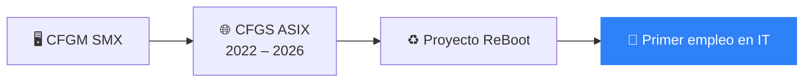

<!--
  README de perfil de GitHub
  1. Crea un repositorio PÚBLICO con el mismo nombre que tu usuario (ej: github.com/TU_USUARIO/TU_USUARIO)
  2. Sube este archivo como README.md
  3. Sustituye TU_USUARIO, TU_NOMBRE, TU_DOMINIO, TU_LINKEDIN y TU_EMAIL
  4. Borra las filas/secciones que no uses
-->

<!-- ✨ NUEVO: banner de cabecera -->

  

<h2 align="center">Técnico en Sistemas y Redes · ASIX </h2>

<!--

-->
---
 
### 🙋 Sobre mí
 
Estudiante de **CFGS en Administración de Sistemas Informáticos en Red (ASIX)**, con formación previa en **Sistemas Microinformáticos y Redes (SMX)**.
Me interesan los servidores Linux, las redes y la virtualización, y aprendo montando mis propios proyectos en un pequeño homelab.
 
Actualmente trabajo en hostelería, donde he desarrollado trabajo en equipo, organización y capacidad de respuesta bajo presión. Busco dar el salto al **sector tecnológico** (prácticas o primer empleo).
 
-  Ahora mismo: terminando ASIX y ampliando mi homelab
-  Aprendiendo: _(ej. Docker)_
-  Cataluña, España
-  Idiomas: Castellano, Catalán, _(otros)_
---

<!-- ✨ NUEVO: frase destacada -->
> 🍳➡️🖥️ *De la cocina al servidor: misma organización, distinto tipo de servicio.*

---

<!-- ✨ NUEVO: proyecto en marcha -->
### ♻️ En construcción: ReBoot

Sistema web para **dar una segunda vida a ordenadores donados**: registra cada equipo que llega, sus averías y reparaciones, y a quién se entrega al final.

🔍 <b>Ver detalles del proyecto</b>

 

- 📦 **Inventario** de equipos donados
- 🔧 **Seguimiento** de averías y reparaciones
- 🤝 **Registro** de destinatarios
- 📈 **Monitorización** del servidor con Zabbix
- 🖥️ **Alojado en mi propio servidor** (HP Elite x2 con Ubuntu Server)

---

<!-- ✨ NUEVO: mi setup -->
### 🧰 Mi setup

| | Equipo | Para qué lo uso |
| :---: | --- | --- |
| 💻 | **PC principal** · Windows 11 | Estudio, desarrollo y documentación |
| 🧪 | Ubuntu Server | Homelab de pruebas y servidor de ReBoot |

---
<!--
### 🚀 Proyectos destacados
 
| Proyecto | Descripción | Stack |
| --- | --- | --- |
| **🌐 [Portafolio web](https://github.com/TU_USUARIO/TU_USUARIO.github.io)** | Mi web personal con experiencia, formación y proyectos, desplegada automáticamente con GitHub Actions | `Astro` `HTML` `CSS` `GitHub Pages` |
| **🖥️ [Homelab](https://github.com/TU_USUARIO/homelab)** | Servidor de pruebas sobre una tableta HP reutilizada: configuración, scripts y documentación | `Ubuntu Server` `Bash` `SSH` |
| **📜 [Scripts](https://github.com/TU_USUARIO/scripts)** | Scripts de automatización para tareas de administración | `Bash` `PowerShell` |
| **🎓 [Prácticas ASIR](https://github.com/TU_USUARIO/asir)** | Prácticas y documentación del ciclo: redes, servicios, bases de datos | `Windows Server` `Linux` `SQL` |
-->
---
<!--
### 🛠️ Tecnologías y herramientas
 
**Sistemas**

 
**Redes y virtualización**

 
**Scripting y bases de datos**

 
**Herramientas**

-->
---
 
### 🎓 Formación
 
- **CFGS Administración de Sistemas Informáticos en Red (ASIX)** · 2022 – 2026
- **CFGM Sistemas Microinformáticos y Redes (SMX)**
---

<!-- ✨ NUEVO: mi camino -->
### 🗺️ Mi camino

---
<!-- 
### 📊 Estadísticas de GitHub
 

  
  

  

---
 

⭐ ¡Gracias por pasarte! Si algo te interesa, no dudes en escribirme.

-->

<!-- ✨ NUEVO: contador de visitas + pie -->

  

  

